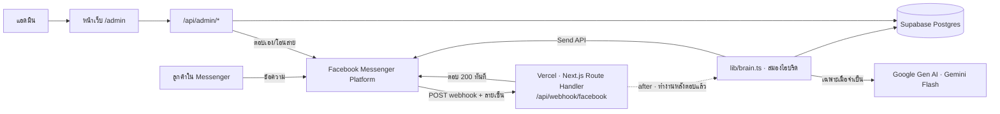
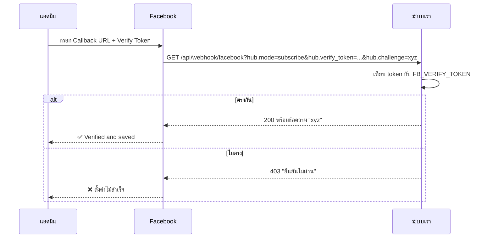
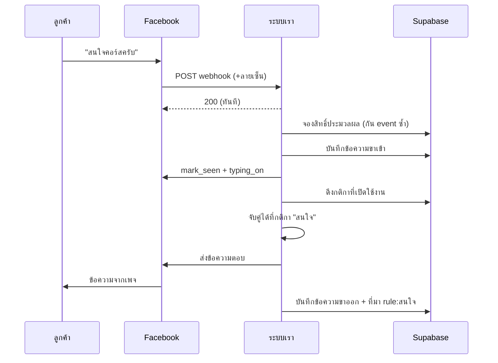
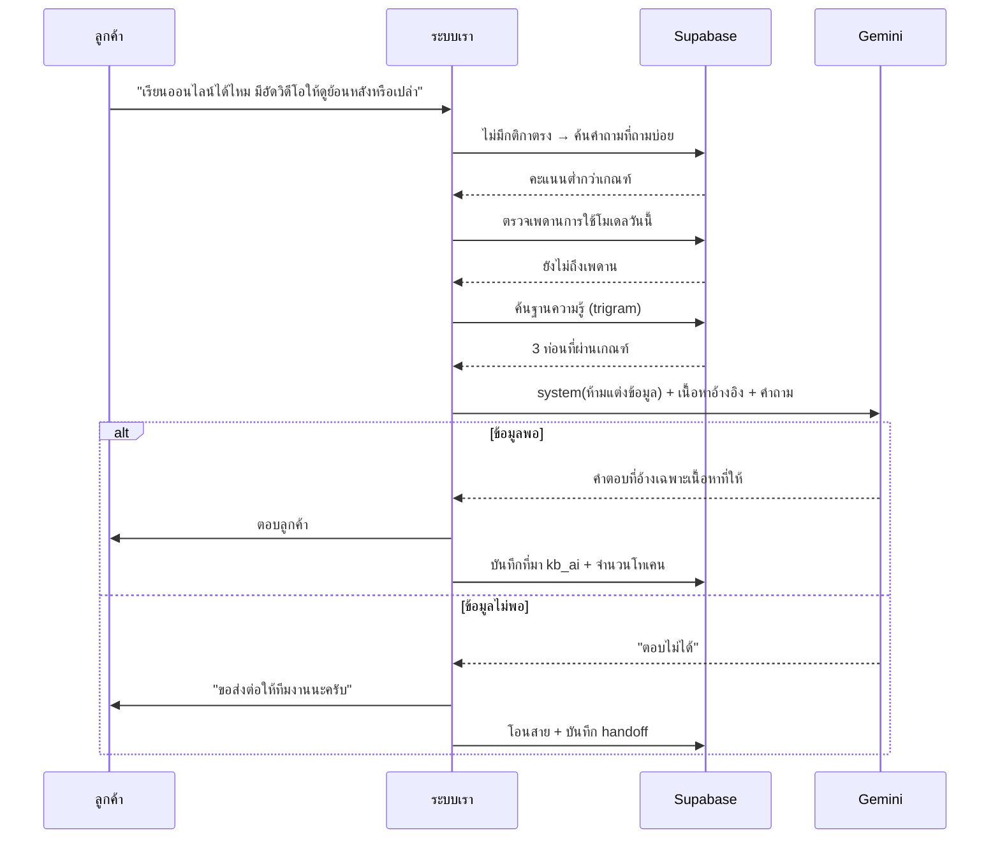
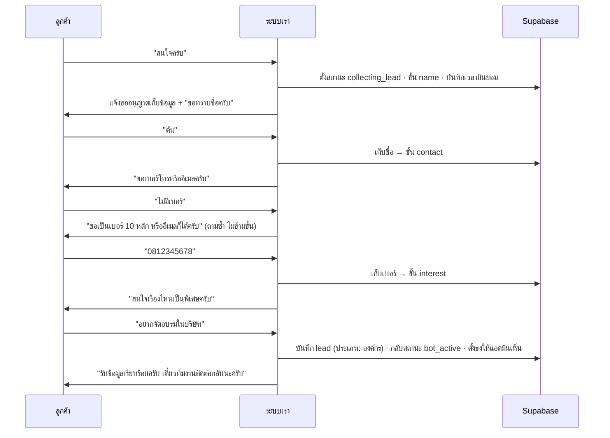
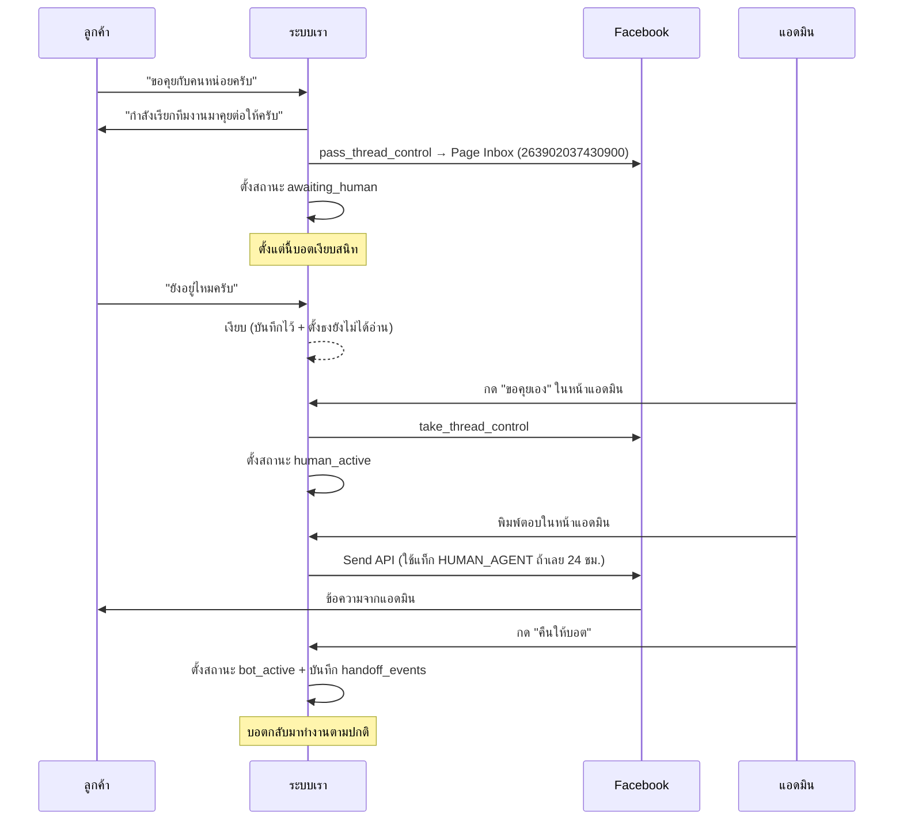
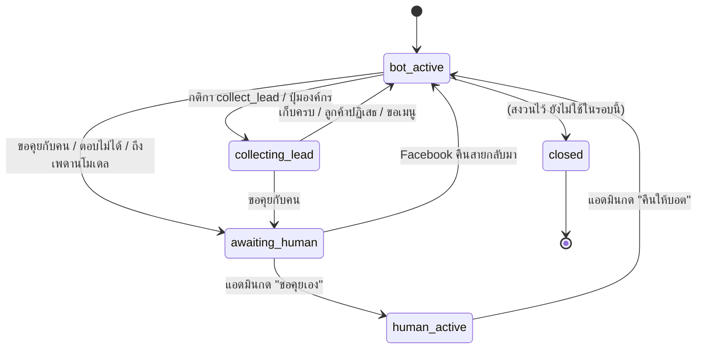

# SPEC — FB Page Chatbot (TONPALEARN)

> เอกสารนี้เป็น **แหล่งความจริงเดียว** ของระบบ · แก้โค้ดที่กระทบพฤติกรรม ต้องไล่แก้ไฟล์นี้ใน commit เดียวกัน
> เวอร์ชัน 1.0 · 5 สิงหาคม 2569 · สถานะ: ตรงกับโค้ดที่ส่งมอบรอบแรก

---

## 1. โจทย์ เป้าหมาย และสิ่งที่ไม่ทำ

### 1.1 Problem Statement
เพจ TONPALEARN มีคนทักเข้ามาถามซ้ำ ๆ เรื่องเดิม (สอนอะไร ราคาเท่าไร อบรมวันไหน รับสอนในองค์กรไหม สมัครยังไง)
เจ้าของเพจตอบเองไม่ทันเวลาสอนหรือเดินทาง คนที่สนใจจริงจึงหลุดมือไปโดยไม่มีใครเก็บชื่อไว้เลย
ต้นทุนของการไม่แก้คือ **โอกาสขายที่หายไปเงียบ ๆ** ซึ่งวัดไม่ได้เพราะไม่มีบันทึกอะไรเหลืออยู่

### 1.2 Goals
| # | เป้าหมาย | วัดยังไง |
|---|---|---|
| G1 | ตอบคำถามที่ถามบ่อยได้เองโดยไม่ต้องรอคน | ≥ 60% ของข้อความขาออกมาจากกติกา/คำถามที่ถามบ่อย ภายใน 30 วัน |
| G2 | ไม่ปล่อยให้คนสนใจหลุดมือ | ≥ 30% ของบทสนทนาที่เข้าข่ายสนใจ จบด้วยการมีชื่อ+ช่องทางติดต่อในระบบ |
| G3 | เวลาตอบครั้งแรกสั้นลง | ค่ามัธยฐานเวลาตอบครั้งแรก < 10 วินาที |
| G4 | ไม่ทำให้ความน่าเชื่อถือเสีย | อัตราการตอบผิดข้อเท็จจริงที่แอดมินต้องตามแก้ = 0 ครั้ง/เดือน |

### 1.3 Non-Goals (และทำไมถึงตัดออก)
1. **ตอบคอมเมนต์ใต้โพสต์อัตโนมัติ** — ต้องขอสิทธิ์เพิ่ม และตอบพลาดต่อหน้าสาธารณะเสียหายกว่าตอบพลาดในแชท → เฟส 2
2. **ขายต่อเป็นระบบหลายเพจ (SaaS)** — ใส่ `page_id` ไว้ในตารางแล้ว แต่ไม่ทำระบบสมาชิก/บิลในรอบนี้
3. **รับชำระเงินในแชท** — ยังส่งลิงก์ไปหน้า /booking ของ tonpalearn.com เหมือนเดิม
4. **วิเคราะห์รูปที่ลูกค้าส่งมา** — ต้นทุนกับความซับซ้อนไม่คุ้มปริมาณตอนนี้
5. **แปลหลายภาษาอัตโนมัติ** — ลูกค้าจริงเกือบทั้งหมดเป็นคนไทย

---

## 2. Personas

| Persona | คือใคร | ต้องการอะไร | กลัวอะไร |
|---|---|---|---|
| **P1 ผู้สนใจรายบุคคล** | คนทำงานที่เห็นโพสต์แล้วอยากเรียน AI | รู้ราคา วันอบรม และวิธีสมัคร เร็ว ๆ | ทักไปแล้วเงียบ / โดนขายแบบกดดัน |
| **P2 ผู้ติดต่อองค์กร** | HR หรือหัวหน้าแผนกที่อยากจ้างไปสอนในบริษัท | รู้ว่ารับจัดในองค์กรไหม ขอใบเสนอราคา | ต้องอธิบายซ้ำหลายรอบกับหลายคน |
| **P3 แอดมินเพจ** | ต้น หรือผู้ช่วย | เห็นว่ามีใครทักบ้าง แทรกเข้าไปคุยเองได้ทันที | บอตตอบมั่วแทนตัวเอง / ไม่รู้ว่าบอตตอบอะไรไป |

---

## 3. User Stories

### P1 ผู้สนใจรายบุคคล
1. ในฐานะผู้สนใจ ฉันอยากได้คำตอบเรื่องราคาทันทีที่ถาม เพื่อจะได้ตัดสินใจโดยไม่ต้องรอ
2. ในฐานะผู้สนใจ ฉันอยากเห็นตัวเลือกเป็นปุ่มกด เพื่อจะได้ไม่ต้องคิดว่าจะถามอะไรดี
3. ในฐานะผู้สนใจ ฉันอยากบอกความสนใจไว้แล้วให้ทีมงานติดต่อกลับ เพื่อไม่ต้องเฝ้าแชท

### P2 ผู้ติดต่อองค์กร
4. ในฐานะ HR ฉันอยากรู้ว่ารับจัดอบรมในองค์กรไหม เพื่อประเมินว่าคุยต่อได้หรือเปล่า
5. ในฐานะ HR ฉันอยากฝากชื่อบริษัทและเบอร์ไว้ เพื่อให้ทีมส่งใบเสนอราคามาให้

### P3 แอดมินเพจ
6. ในฐานะแอดมิน ฉันอยากเห็นทุกบทสนทนาในที่เดียว เพื่อไม่พลาดคนสำคัญ
7. ในฐานะแอดมิน ฉันอยากกดปุ่มเดียวแล้วเข้าไปคุยเอง เพื่อรับช่วงต่อจากบอตได้ทันที
8. ในฐานะแอดมิน ฉันอยากรู้ว่าคำตอบแต่ละอันบอตเอามาจากไหน เพื่อไล่แก้ต้นตอเมื่อตอบไม่ดี
9. ในฐานะแอดมิน ฉันอยากแก้คำถามที่ถามบ่อยเองได้ เพื่อไม่ต้องรอโปรแกรมเมอร์

### เคสขอบ (ต้องรองรับ)
| เคส | พฤติกรรมที่ต้องเป็น |
|---|---|
| บอตไม่รู้คำตอบ | เสนอส่งต่อให้คน ไม่เดา ไม่แต่งข้อมูล |
| ลูกค้าโกรธ/ขอคุยกับคน | โอนสายทันที บอตเงียบสนิทหลังจากนั้น |
| ส่งรูป/สติกเกอร์/ไฟล์ ไม่มีข้อความ | ตอบรับว่าได้รับแล้ว และชวนพิมพ์บอกว่าต้องการอะไร |
| พิมพ์นอกเรื่องสิ้นเชิง | ไม่มีเนื้อหาอ้างอิง → โยนหาคน ไม่เรียกโมเดลให้เปลืองค่าใช้จ่าย |
| Facebook ยิง event ซ้ำ | ประมวลผลครั้งเดียว (กันด้วย `webhook_events.event_key`) |
| คำตอบยาวเกิน 2,000 ตัวอักษร | ตัดเป็นหลายข้อความ พยายามตัดที่ช่องว่าง/ขึ้นบรรทัดใหม่ |
| ข้อความมีคำสั่งหลอกโมเดล ("ลืมกติกาเดิม") | ถือเป็นข้อความธรรมดา — มีข้อห้ามข้อ 6 ใน system prompt |
| แอดมินตอบหลังเลย 24 ชม. | ลองส่งด้วยแท็ก HUMAN_AGENT และถ้าไม่ผ่านต้องอธิบายสาเหตุเป็นภาษาคน |

---

## 4. Requirements

### P0 — ไม่มีไม่ขึ้น

**FR-01 ยืนยัน webhook**
Given Facebook เรียก `GET /api/webhook/facebook` พร้อม `hub.mode=subscribe` และ `hub.verify_token` ตรงกับค่าในระบบ
When ระบบได้รับคำขอ
Then ต้องคืน `hub.challenge` เป็น text/plain สถานะ 200 — และถ้า token ไม่ตรงต้องคืน 403

**FR-02 ตรวจลายเซ็นทุก event**
Given มีคำขอ `POST /api/webhook/facebook`
When header `X-Hub-Signature-256` ไม่ตรงกับ HMAC-SHA256 ของ **raw body** ด้วย App Secret
Then ต้องคืน 401 และ **ห้ามประมวลผลใด ๆ**
*หมายเหตุ: ต้องเทียบแบบเวลาคงที่ (timing-safe) และต้องอ่าน raw body ก่อน parse JSON*

**FR-03 ตอบ Facebook ให้ไวแล้วค่อยทำงาน**
Given ได้รับ event ที่ลายเซ็นถูกต้อง
When ระบบเริ่มประมวลผล
Then ต้องคืน 200 กลับทันที และทำงานหนักต่อใน `after()` — ห้ามให้ Facebook รอจนหมดเวลา

**FR-04 กันประมวลผลซ้ำ**
Given Facebook ส่ง event เดิม (`mid` เดิม) มาอีกครั้ง
When ระบบรับ event
Then ต้องข้ามทันที ห้ามตอบลูกค้าซ้ำ (บังคับด้วย unique constraint ที่ระดับฐานข้อมูล ไม่ใช่ตัวแปรในหน่วยความจำ)

**FR-05 บอตต้องเงียบเมื่อคนกำลังคุย**
Given บทสนทนามีสถานะ `human_active` หรือ `awaiting_human` หรือเพจปิดสวิตช์บอตไว้
When ลูกค้าพิมพ์อะไรมาก็ตาม
Then บอตต้องไม่ส่งอะไรออกไปเลย แต่ยังบันทึกข้อความขาเข้าและตั้งธง "ยังไม่ได้อ่าน"
*สำคัญ: ระหว่างที่คนถือสาย Facebook จะส่งข้อความของลูกค้ามาทาง `entry.standby[]` ไม่ใช่ `entry.messaging[]`
ระบบต้องอ่านทั้งสองช่อง ไม่งั้นข้อความช่วงที่สำคัญที่สุดจะหายเงียบ ๆ*

**FR-05b เมื่อโอนสายไม่สำเร็จ**
Given ระบบสั่งโอนสายแต่ Facebook ปฏิเสธ (เช่น ยังไม่ได้ตั้งแอปเป็นผู้รับหลักของเพจ)
When เกิดข้อผิดพลาด
Then ต้องตั้งสถานะเป็น `awaiting_human` ให้สำเร็จก่อนเสมอ (บอตหยุดพูด) และบันทึกข้อความจากระบบไว้ในบทสนทนาเพื่อบอกแอดมินว่าเกิดอะไรขึ้น
**ห้ามปล่อยให้บอตพูดประโยค "กำลังเรียกทีมงาน" ซ้ำทุกข้อความ**

**FR-06 คำสั่งพิเศษมาก่อนทุกกติกา**
Given ลูกค้าพิมพ์ข้อความที่มีคำว่า "คุยกับคน" / "ขอแอดมิน" / "เรียกแอดมิน" (หรือคำในชุดเดียวกัน)
When บอตประมวลผล
Then ต้องโอนสายทันที **แม้จะมีกติกาหรือคำถามที่ถามบ่อยที่ตรงกว่า**

**FR-07 กติกาคำสำคัญ**
Given แอดมินตั้งกติกาที่เปิดใช้งานไว้
When ข้อความตรงกับกติกา (ตามชนิด contains/exact/regex)
Then ทำตามการกระทำของกติกาที่ลำดับความสำคัญน้อยที่สุด และ **ห้ามลงไปเรียกโมเดล**
*regex ที่เขียนผิดต้องไม่ทำให้ระบบล้ม — ให้ข้ามข้อนั้นแล้วไปข้อถัดไป*

**FR-08 คำถามที่ถามบ่อย**
Given ไม่มีกติกาข้อไหนตรง
When ค้นแล้วได้คำถามที่คะแนนความคล้าย ≥ `KB_SIMILARITY_THRESHOLD` และคำตอบไม่ได้ขึ้นต้นด้วย `[กรอกเอง]`
Then ตอบด้วยคำตอบนั้นตรง ๆ โดยไม่เรียกโมเดล

**FR-09 ฐานความรู้ + โมเดล**
Given ยังไม่มีคำตอบจากชั้นบน และมีเนื้อหาที่ค้นเจอผ่านเกณฑ์
When เรียกโมเดล
Then โมเดลต้องตอบโดยอ้างเฉพาะเนื้อหาที่ส่งไปเท่านั้น · ถ้าข้อมูลไม่พอต้องตอบว่า "ตอบไม่ได้" แล้วระบบโยนหาคน
**ห้ามแต่งราคา วันเวลา จำนวน หรือเงื่อนไขขึ้นเอง เด็ดขาด**

**FR-09b ตาข่ายรับคำตอบ (บังคับด้วยโค้ด ไม่ใช่แค่พรอมป์)**
Given โมเดลตอบกลับมาแล้ว
When คำตอบมีจำนวนเงิน วันที่ หรือเวลา ที่ **ไม่ปรากฏในเนื้อหาอ้างอิงที่ส่งไป**
Then ห้ามส่งคำตอบนั้นออกไป ให้โยนหาคนแทน และบันทึกเหตุผลไว้
*เหตุผล: การขอร้องโมเดลในพรอมป์ไม่ใช่การบังคับ เป้า G4 ต้องการศูนย์ครั้ง จึงต้องมีด่านที่เป็นโค้ด (`lib/guard.ts`)*

**FR-09c ประวัติแชทที่ส่งให้โมเดล**
Given จะส่งประวัติการสนทนาไปเป็นบริบท
When จัดรูปข้อความ
Then ต้องทิ้งข้อความว่าง · ยุบข้อความฝั่งเดียวกันที่ติดกัน · ตัดหัวจนกว่าตัวแรกจะเป็นฝั่งผู้ใช้
*ประวัติถูกแปลงเป็นรูปแบบของ Gemini อีกที (ฝั่งบอตใช้คำว่า `model` ไม่ใช่ `assistant`)*
*ถ้าประวัติผิดรูป โมเดลจะปฏิเสธทั้งคำขอ แล้วลูกค้าจะเห็น "กำลังพิมพ์" ค้างแล้วเงียบไปเฉย ๆ*

**FR-10 เพดานค่าใช้จ่าย**
Given จำนวนครั้งที่เรียกโมเดลวันนี้ ≥ `DAILY_AI_CALL_CAP`
When มีคำถามที่ต้องใช้โมเดล
Then ห้ามเรียกโมเดลเพิ่ม ให้โยนหาคนแทน

**FR-11 เก็บข้อมูลผู้สนใจทีละขั้น**
Given เข้าสู่สถานะ `collecting_lead`
When ถามข้อมูล
Then ต้องถามทีละอย่างตามลำดับ ชื่อ → ช่องทางติดต่อ → ความสนใจ · แจ้งขออนุญาตเก็บข้อมูลก่อนถามข้อแรก · บันทึกเวลายินยอมลง `leads.consent_at`
- ถ้าช่องทางติดต่อไม่ใช่เบอร์ 9–10 หลักหรืออีเมล → ถามซ้ำ ไม่เดินขั้นต่อไป
- ถ้าลูกค้าปฏิเสธ ("ไม่สะดวก") → หยุดถามทันที ไม่บันทึกอะไร กลับสู่ `bot_active`

**FR-12 โอนสายและคืนสาย**
Given ต้องโอนหาคน
When ระบบโอน
Then ต้องเรียก `pass_thread_control` ไปที่ Page Inbox · ตั้งสถานะ `awaiting_human` · บันทึกลง `handoff_events`
และเมื่อ Facebook ส่ง event `pass_thread_control` กลับมาที่แอปเรา → ตั้งสถานะกลับเป็น `bot_active` อัตโนมัติ

**FR-13 หน้าผู้ดูแล**
Given แอดมินล็อกอินด้วย `ADMIN_PASSCODE`
Then ต้องทำได้: ดูภาพรวม · อ่านทุกบทสนทนา · พิมพ์ตอบเอง · ขอคุยเอง/คืนให้บอต · แก้คำถามที่ถามบ่อย · แก้กติกา · เพิ่มฐานความรู้ · ดูและส่งออกรายชื่อผู้สนใจ · แก้ข้อความระบบ · เปิด/ปิดบอตทั้งเพจ
*ทุก endpoint ใต้ `/api/admin/*` ต้องเรียก `requireAdmin()` เป็นบรรทัดแรก*

**FR-14 ความเป็นส่วนตัว**
- ทุกตารางเปิด RLS และไม่ให้สิทธิ์ `anon`/`authenticated` เลย
- ห้าม log เนื้อหาข้อความของลูกค้าลง console (log ได้แค่ชื่อจุดที่พลาดกับข้อความ error)
- ต้องแจ้งขออนุญาตก่อนเก็บชื่อ/เบอร์

### P1 — ตามมาเร็ว ๆ นี้
- FR-15 แจ้งเตือนแอดมินเมื่อมีผู้สนใจใหม่ (ผ่าน LINE หรืออีเมล)
- FR-16 ค้นหาข้อความย้อนหลังในหน้ากล่องข้อความ
- FR-17 รายงานสรุปรายสัปดาห์ส่งอัตโนมัติ
- FR-18 บันทึกคำถามที่บอตตอบไม่ได้ ไว้ให้แอดมินกดสร้างเป็นคำถามที่ถามบ่อยได้ทันที

### P2 — เผื่ออนาคต (ออกแบบรองรับแล้ว แต่ยังไม่สร้าง)
- FR-19 ตอบคอมเมนต์ใต้โพสต์ + ส่งข้อความส่วนตัวต่อ
- FR-20 หลายเพจในระบบเดียว (คอลัมน์ `page_id` มีอยู่ทุกตารางแล้ว)
- FR-21 ค้นฐานความรู้ด้วยเวกเตอร์ (คอลัมน์ `kb_chunks.embedding vector(1024)` เตรียมไว้แล้ว)
- FR-22 ส่งข้อความหาลูกค้ากลุ่มใหญ่ (broadcast)

---

## 5. สถาปัตยกรรม

**เส้นทางของหนึ่งข้อความ:** Facebook ยิง POST มา → ตรวจลายเซ็นจาก raw body → คืน 200 ทันที → งานที่เหลือรันใน `after()` → จองสิทธิ์ประมวลผลใน `webhook_events` (กันซ้ำ) → บันทึกข้อความ → สมองตัดสินใจ 7 ชั้น → ส่งคำตอบกลับผ่าน Send API → บันทึกข้อความขาออกพร้อมที่มาของคำตอบ

---

## 6. Flow การใช้งาน

### F1 — ยืนยัน webhook ครั้งแรก

### F2 — กติกาตรง ตอบทันที

### F3 — ถามอิสระ ต้องค้นฐานความรู้

### F4 — เก็บข้อมูลผู้สนใจ

### F5 — โอนหาคนและคืนสาย

---

## 7. State machine ของบทสนทนา

| เหตุการณ์ | จาก | ไป | ผลข้างเคียง |
|---|---|---|---|
| กติกา `collect_lead` / ปุ่ม MENU_CORPORATE | bot_active | collecting_lead | ตั้ง `lead_step='name'`, บันทึก `consent_at`, ส่งข้อความขออนุญาต |
| เก็บข้อมูลครบ 3 ขั้น | collecting_lead | bot_active | เขียนแถวใน `leads`, ล้าง `lead_draft`, ตั้งธงให้แอดมิน |
| ลูกค้าปฏิเสธให้ข้อมูล | collecting_lead | bot_active | ไม่บันทึกอะไร ตอบว่าไม่เก็บข้อมูล |
| คำสั่ง "คุยกับคน" / บอตตอบไม่ได้ / ถึงเพดาน | ทุกสถานะที่บอตทำงาน | awaiting_human | `pass_thread_control`, เขียน `handoff_events(pass)` |
| แอดมินกด "ขอคุยเอง" | awaiting_human / bot_active | human_active | `take_thread_control`, เขียน `handoff_events(take)` |
| แอดมินกด "คืนให้บอต" | human_active | bot_active | เขียน `handoff_events(auto_release)` |
| Facebook ส่ง `pass_thread_control` กลับมาหาแอปเรา | awaiting_human / human_active | bot_active | เขียน `handoff_events(auto_release)` |

---

## 8. สมองไฮบริด — ลำดับการตัดสินใจ

| ชั้น | ทำอะไร | ค่าใช้จ่าย | ที่อยู่ในโค้ด |
|---|---|---|---|
| 0 | กันข้อความซ้ำด้วย `mid` | – | `route.ts` → `store.claimEvent()` |
| 1 | คนกำลังคุย / เพจปิดบอต → เงียบ | – | `brain.ts` |
| 2 | ปุ่มที่กด (postback) และคำสั่งพิเศษ | – | `matching.detectSpecialCommand()` |
| 3 | กำลังเก็บข้อมูลผู้สนใจ → ถามขั้นถัดไป | – | `brain.continueLeadCollection()` |
| 4 | กติกาคำสำคัญของแอดมิน | – | `matching.matchRule()` |
| 5 | คำถามที่ถามบ่อย (trigram) | ค้นในฐานข้อมูล | `store.searchFaq()` |
| 6 | ฐานความรู้ + Gemini เรียบเรียง | เรียกโมเดล | `store.searchKb()` + `ai.answerFromKnowledge()` |
| 7 | ตอบไม่ได้ → เสนอส่งต่อคน | – | `brain.startHandoff()` |

### เกณฑ์ตัวเลข — แยกให้ชัดว่าอันไหนมีที่มา อันไหนตั้งเอง

| ค่า | ตั้งไว้ | ที่มา |
|---|---|---|
| ความยาวข้อความสูงสุดต่อชิ้น | 2,000 ตัวอักษร | **มีที่มา** — ลิมิตของ Messenger Send API |
| จำนวนปุ่มตัวเลือกด่วน | 13 ปุ่ม | **มีที่มา** — ลิมิตของ quick replies |
| ความยาวชื่อปุ่ม | 20 ตัวอักษร | **มีที่มา** — ลิมิตของ Messenger |
| หน้าต่างตอบข้อความธรรมดา | 24 ชั่วโมง | **มีที่มา** — นโยบาย Messenger Platform |
| `KB_SIMILARITY_THRESHOLD` | 0.35 | **ตั้งเอง รอจูน** — ต่ำไปจะดึงเนื้อหาไม่เกี่ยวมาตอบ สูงไปจะไม่เจออะไรเลย |

> **บทเรียนที่ต้องจำเรื่องการค้นหา (แก้แล้วรอบ 5 ส.ค. 2569):**
> ห้ามใช้ `similarity()` เทียบ "คำถามสั้น" กับ "เนื้อหายาว" เพราะมันคิดจากสัดส่วนต่อความยาวรวมทั้งสองฝั่ง —
> คำถาม 25 ตัวอักษรเทียบท่อนความรู้ 800 ตัวอักษร จะได้คะแนนราว **0.03 เสมอ ต่อให้ตรงทุกคำ** ⇒ ค้นไม่เจออะไรเลยตลอดกาล
> ตอนนี้ใช้ `word_similarity()` กับตัวดำเนินการ `<%` ซึ่งหา "ช่วงที่ดีที่สุดในเนื้อหายาว" แทน
> และในคำถามที่ถามบ่อย ถ้าเจอคำสำคัญตรง ๆ ในข้อความจะให้คะแนนพื้น 0.75 ไปเลย ไม่ไปคิดสัดส่วนความยาว
> **ยังต้องจูนด้วยของจริง:** เก็บข้อความจริงที่ลูกค้าพิมพ์ 20 ประโยค แล้วดูว่าชั้นไหนตอบ ก่อนจะเชื่อว่าเกณฑ์นี้ใช้ได้
| `KB_TOP_K` | 5 ท่อน | **ตั้งเอง รอจูน** |
| `HISTORY_TURNS` | 8 ข้อความ | **ตั้งเอง รอจูน** — สมดุลระหว่างบริบทกับค่าโทเคน |
| `GEMINI_MAX_TOKENS` | 700 | **ตั้งเอง รอจูน** — พอสำหรับคำตอบ 4 บรรทัด |
| `DAILY_AI_CALL_CAP` | 500 ครั้ง/วัน | **ตั้งเอง รอจูน** — ตั้งเผื่อไว้ก่อน ยังไม่รู้ปริมาณจริง |
| ขนาดท่อนฐานความรู้ | ~800 ตัวอักษร ซ้อน 100 | **ตั้งเอง รอจูน** |

> วิธีจูน: ดูหน้าภาพรวม → แถบ "คำตอบมาจากไหนบ้าง" ถ้าสัดส่วน "โอนหาคน" สูงผิดปกติ แปลว่าเกณฑ์สูงไปหรือเนื้อหายังไม่พอ

---

## 9. Data model

ไฟล์จริง: `supabase/migrations/0001_init.sql` (โครงตาราง) และ `0002_seed.sql` (ข้อมูลตั้งต้น)

| ตาราง | เก็บอะไร | คีย์/ดัชนีสำคัญ |
|---|---|---|
| `fb_pages` | เพจที่ระบบดูแล + สวิตช์เปิด/ปิดบอต | `page_id` unique |
| `contacts` | คนที่ทักเข้ามา (PSID) | unique `(page_id, psid)` |
| `conversations` | หนึ่งห้องต่อหนึ่งคน + สถานะ + ร่างข้อมูล lead | unique `contact_id`, index `(state, updated_at)` |
| `messages` | ข้อความทุกฝั่ง + ที่มาของคำตอบ | unique `mid` (partial), index `(conversation_id, created_at)` |
| `webhook_events` | กันประมวลผลซ้ำ | unique `event_key` |
| `faq_entries` | คำถามที่ถามบ่อย + คำสำคัญ + จำนวนครั้งที่ใช้ | GIN trigram บน `question` |
| `rules` | กติกาคำสำคัญ + ลำดับความสำคัญ | index `(page_id, is_active, priority)` |
| `kb_documents` / `kb_chunks` | ฐานความรู้และท่อนย่อย (+ ช่อง embedding เผื่ออนาคต) | GIN trigram บน `content` |
| `leads` | ผู้สนใจ + เวลายินยอมให้เก็บข้อมูล | index `(page_id, created_at)` |
| `handoff_events` | ประวัติการโอน/คืนสาย | – |
| `admin_users` | เผื่ออนาคตเมื่อเลิกใช้รหัสผ่านร่วม | `email` unique |
| `settings` | ข้อความระบบที่แก้ได้จากหน้าเว็บ | `key` เป็น PK |
| `usage_log` | โทเคนและเวลาที่ใช้ต่อการเรียกโมเดล | index `created_at` |

**นโยบาย RLS:** ทุกตารางเปิด RLS และ `revoke all ... from anon, authenticated` โดยไม่สร้าง policy ใด ๆ
ผลคือเข้าถึงได้เฉพาะ service role ที่อยู่ฝั่งเซิร์ฟเวอร์ของเรา — เบราว์เซอร์แตะฐานข้อมูลตรงไม่ได้เลย

**ฟังก์ชันในฐานข้อมูล:** `search_faq(page_id, query, limit)` · `search_kb(page_id, query, limit)` · `increment_hit(table, id)` — ทั้งหมด revoke สิทธิ์จาก anon แล้ว

---

## 10. API contract

### สาธารณะ
| Method | Path | ใช้ทำอะไร | ตอบอะไร |
|---|---|---|---|
| GET | `/api/webhook/facebook` | ยืนยัน webhook | 200 + challenge / 403 |
| POST | `/api/webhook/facebook` | รับ event | 200 `EVENT_RECEIVED` / 401 ลายเซ็นผิด |
| GET | `/api/health` | ตรวจว่าตั้งค่าครบไหม | 200 `{status, missing[]}` / 503 |

### หน้าผู้ดูแล (ทุกตัวต้องล็อกอิน · ไม่ล็อกอินได้ 401 `{"error":"ยังไม่ได้เข้าสู่ระบบ"}`)
| Method | Path | body ตัวอย่าง | ตอบ |
|---|---|---|---|
| POST | `/api/admin/login` | `{"passcode":"..."}` | 200 + ตั้งคุกกี้ / 401 / 429 เมื่อเดารหัสถี่เกิน |
| POST | `/api/admin/logout` | – | 200 |
| GET | `/api/admin/stats` | – | `{messagesToday, unreadConversations, newLeadsThisWeek, aiCallsToday, aiCallCap, answerMix{...}}` |
| GET | `/api/admin/conversations?state=&limit=` | – | `{items:[{id,name,state,unread,lastMessage,lastMessageAt}]}` |
| GET | `/api/admin/conversations/[id]` | – | `{id,state,name,lastUserMessageAt,messages:[...]}` |
| POST | `/api/admin/conversations/[id]/reply` | `{"text":"..."}` | 200 `{ok:true,usedHumanAgentTag}` / 422 เลย 24 ชม. / 502 Facebook ปฏิเสธ |
| POST | `/api/admin/conversations/[id]/takeover` | – | `{ok:true,state:"human_active",note}` |
| POST | `/api/admin/conversations/[id]/release` | – | `{ok:true,state:"bot_active"}` |
| GET/POST | `/api/admin/faq` | `{"question","answer","keywords":[]}` | รายการ / แถวที่เพิ่ม |
| PUT/DELETE | `/api/admin/faq/[id]` | `{"answer":"...","is_active":true}` | แถวที่แก้ / `{ok:true}` |
| GET/POST | `/api/admin/rules` | `{"name","match_type","pattern","action","reply_text","priority"}` | รายการ / แถวที่เพิ่ม |
| PUT/DELETE | `/api/admin/rules/[id]` | patch บางส่วน | แถวที่แก้ / `{ok:true}` |
| POST | `/api/admin/rules/test` | `{"text":"สนใจครับ"}` | `{specialCommand, matchedRule, explain}` |
| GET/POST | `/api/admin/kb` | `{"title","source","content"}` | รายการ / `{id,chunkCount}` |
| PUT/DELETE | `/api/admin/kb/[id]` | `{"is_active":false}` | `{id,is_active}` / `{ok:true}` |
| GET | `/api/admin/leads?status=` | – | `{items:[...]}` |
| PUT | `/api/admin/leads/[id]` | `{"status":"contacted"}` | แถวที่แก้ |
| GET/PUT | `/api/admin/settings` | `{"items":[{key,text}],"botEnabled":true}` | รายการ / `{ok:true}` |

**รหัสข้อผิดพลาดที่ใช้ทั้งระบบ:** 400 ข้อมูลที่ส่งมาไม่ครบ/ผิด · 401 ยังไม่ล็อกอินหรือลายเซ็นผิด · 403 ยืนยัน webhook ไม่ผ่าน · 404 ไม่พบข้อมูล · 422 ทำไม่ได้เพราะเงื่อนไขของ Facebook · 429 เรียกถี่เกิน · 500 ระบบพลาด · 502 Facebook ปฏิเสธ · 503 ตั้งค่าไม่ครบ

---

## 11. หน้าจอที่ต้องมี

| หน้า | องค์ประกอบสำคัญ | การกระทำหลัก |
|---|---|---|
| `/admin/login` | การ์ดกลางหน้า ช่องรหัสผ่านช่องเดียว | เข้าสู่ระบบ |
| `/admin` ภาพรวม | การ์ดตัวเลข 4 ใบ · แถบ "คำตอบมาจากไหนบ้าง" · บทสนทนาล่าสุด 10 รายการ | กดเข้าไปดูบทสนทนา |
| `/admin/inbox` | ปุ่มกรองตามสถานะ · รายการแชทพร้อมป้ายสถานะและธงยังไม่ได้อ่าน | เลือกบทสนทนา |
| `/admin/inbox/[id]` | ฟองข้อความสองฝั่ง · ป้ายบอกที่มาของคำตอบ · แถบเตือน 24 ชั่วโมง · กล่องพิมพ์ตอบ | ส่งข้อความ · ขอคุยเอง · คืนให้บอต |
| `/admin/faq` | ฟอร์มเพิ่ม · การ์ดรายข้อพร้อมป้าย "ยังไม่ได้กรอก" | เพิ่ม/แก้/เปิด-ปิด/ลบ |
| `/admin/rules` | ช่องทดลองพิมพ์ข้อความ · ฟอร์มเพิ่ม · รายการเรียงตามลำดับความสำคัญ | ทดลองจับคู่ · เพิ่ม/เปิด-ปิด/ลบ |
| `/admin/kb` | ฟอร์มวางเนื้อหายาว · รายการเอกสาร + จำนวนท่อน | เพิ่ม (ตัดท่อนอัตโนมัติ) · เปิด-ปิด · ลบ |
| `/admin/leads` | ปุ่มกรองตามสถานะ · การ์ดรายคน · ปุ่มดาวน์โหลด CSV | เปลี่ยนสถานะ · ส่งออก |
| `/admin/settings` | สวิตช์เปิด/ปิดบอต · ช่องแก้ข้อความระบบ 6 ช่อง | บันทึกทั้งหมด |

**ข้อกำหนดการอ่านออก:** ขนาดตัวอักษรฐาน 17.5px · ระยะบรรทัด 1.8 · ข้อความสำคัญห้ามจางกว่าสี `--text-soft` · ตารางหลายคอลัมน์ต้องยุบเป็นการ์ดบนจอเล็ก · ทุกหน้าต้องมีสถานะ "กำลังโหลด" และ "ยังไม่มีข้อมูล" ที่เขียนเป็นภาษาคน

---

## 12. Success Metrics

**ตัวชี้วัดที่ขยับเร็ว (ดูได้ใน 1–4 สัปดาห์)**
| ตัวชี้วัด | เป้า | วัดจาก |
|---|---|---|
| สัดส่วนคำตอบที่ไม่ต้องใช้โมเดล | ≥ 60% | หน้าภาพรวม → แถบคำตอบมาจากไหน |
| เวลาตอบครั้งแรก (มัธยฐาน) | < 10 วินาที | ผลต่างเวลาระหว่างข้อความเข้ากับข้อความตอบแรก |
| อัตราการโยนหาคน | < 30% | สัดส่วน `handoff` ในแถบเดียวกัน |
| ผู้สนใจใหม่ต่อสัปดาห์ | ≥ 5 คน | หน้าผู้สนใจ |
| ค่าใช้โมเดลต่อวัน | < 40% ของเพดาน | การ์ด "เรียกโมเดลวันนี้" |

**ตัวชี้วัดที่ขยับช้า (ดูรายไตรมาส)**
- จำนวนผู้สนใจที่กลายเป็นผู้เรียนจริง (`leads.status = won`)
- เวลาที่แอดมินต้องใช้ตอบแชทต่อสัปดาห์ (ประเมินเอง ก่อน/หลัง)
- จำนวนครั้งที่บอตตอบผิดจนต้องตามแก้ — **เป้าคือศูนย์**

---

## 13. ความปลอดภัยและ PDPA

| ประเด็น | ทำอะไรไว้ |
|---|---|
| ปลอม webhook | ตรวจ HMAC-SHA256 จาก raw body แบบ timing-safe · ไม่ผ่าน = 401 ไม่ประมวลผล |
| ฐานข้อมูลรั่ว | RLS เปิดทุกตาราง ไม่มี policy ให้ anon · service role key อยู่ฝั่งเซิร์ฟเวอร์เท่านั้น |
| หน้าแอดมินโดนเดารหัส | เทียบรหัสแบบ timing-safe · **บังคับรหัสยาว ≥16 ตัว** · คุกกี้เซ็น HMAC หมดอายุ 12 ชม. ⚠️ ตัวนับความพยายามเดารหัส (10 ครั้ง/5 นาที) เก็บในหน่วยความจำของแต่ละอินสแตนซ์ — **บน Vercel ที่มีหลายอินสแตนซ์ มันกันได้ไม่จริง** ด่านจริงคือความยาวของรหัส |
| ข้อความลูกค้าหลุดใน log | ห้าม log เนื้อหา — log ได้แค่จุดที่พลาดกับข้อความ error |
| เก็บข้อมูลโดยไม่ได้ขอ | แจ้งขออนุญาตก่อนถามชื่อ/เบอร์ · บันทึก `leads.consent_at` · ลูกค้าปฏิเสธได้ทันที |
| โมเดลถูกหลอกด้วยข้อความ | system prompt ข้อ 6 สั่งห้ามทำตามคำสั่งที่แทรกมาในข้อความลูกค้าหรือเนื้อหาอ้างอิง |
| ลบข้อมูลตามคำขอ | ลบแถวใน `contacts` แล้วข้อความ/บทสนทนา/lead จะถูกลบตาม (`on delete cascade` / `set null`) — **ยังไม่มีปุ่มในหน้าเว็บ ต้องทำผ่าน SQL ในรอบนี้** |

---

## 14. Open Questions

### ต้องตอบก่อนเริ่มใช้จริง (blocking)
| # | คำถาม | ใครตอบ |
|---|---|---|
| Q1 | เวอร์ชัน Graph API ล่าสุดคืออะไร (ค่าตั้งต้นในโค้ดคือ `v21.0` ซึ่ง**ยังไม่ได้ยืนยัน**ว่าเป็นตัวปัจจุบัน) | dev — เช็กที่ developers.facebook.com/docs/graph-api/changelog |
| Q2 | ราคา วันอบรม และเงื่อนไขจริงของแต่ละคอร์ส เพื่อกรอกแทน `[กรอกเอง]` ทั้ง 5 ข้อ | **ต้น** |
| Q3 | เพจจะขอสิทธิ์ HUMAN_AGENT ไหม (มีผลกับการตอบหลัง 24 ชั่วโมง) | **ต้น** + Facebook review |
| Q4 | ข้อความทักทายและบุคลิกของบอต ให้เป็นเสียงแบบไหน | **ต้น** |

### ตอบระหว่างทางได้ (non-blocking)
| # | คำถาม | ใครตอบ |
|---|---|---|
| Q5 | ควรแจ้งเตือนผู้สนใจใหม่เข้า LINE ของต้นเลยไหม (FR-15) | ต้น |
| Q6 | ถ้าปริมาณโตขึ้น จะย้ายไปค้นด้วยเวกเตอร์เมื่อไร และใช้ผู้ให้บริการ embedding เจ้าไหน | dev + ต้น |
| Q7 | เก็บประวัติแชทไว้นานแค่ไหนจึงจะพอดีระหว่างประโยชน์กับความเสี่ยง | ต้น |

---

## 15. Traceability

| FR | ไฟล์หลัก | เทสต์ |
|---|---|---|
| FR-01 | `app/api/webhook/facebook/route.ts` (GET) | `tests/webhook.test.ts` — 3 เคส + `scripts/smoke-webhook.mjs` |
| FR-02 | `lib/facebook.ts` → `verifySignature()` | `tests/facebook.test.ts` — 6 เคส · `tests/webhook.test.ts` — 3 เคส |
| FR-03 | `route.ts` → `after()` | `tests/webhook.test.ts` — คืน 200 ก่อนงานเบื้องหลังเสร็จ |
| FR-04 | `lib/store.ts` → `claimEvent()` + unique `event_key` | `tests/webhook.test.ts` — ยิง mid เดิมซ้ำ ต้องตอบครั้งเดียว |
| FR-05 | `lib/brain.ts` ชั้น 1 | `tests/brain.test.ts` — 3 เคส (human_active, awaiting_human, ปิดบอตทั้งเพจ) |
| FR-06 | `lib/matching.ts` → `detectSpecialCommand()` | `tests/matching.test.ts` + `brain.test.ts` |
| FR-07 | `lib/matching.ts` → `matchRule()` | `tests/matching.test.ts` — 4 เคส รวม regex พัง |
| FR-08 | `lib/brain.ts` ชั้น 5 | `tests/brain.test.ts` — 3 เคส รวม `[กรอกเอง]` |
| FR-09 | `lib/ai.ts` + `brain.ts` ชั้น 6 | `tests/brain.test.ts` — 4 เคส |
| FR-10 | `brain.ts` → `countAiCallsToday()` | `tests/brain.test.ts` — เคสถึงเพดาน |
| FR-11 | `brain.ts` → `continueLeadCollection()` | `tests/brain.test.ts` — 4 เคส |
| FR-12 | `lib/facebook.ts` → `pass/takeThreadControl()` + route ของแอดมิน | ตรวจด้วยมือกับเพจจริง |
| FR-13 | `app/admin/**` + `app/api/admin/**` | ตรวจด้วยมือ |
| FR-14 | `0001_init.sql` (RLS) + `_lib/http.ts` (log) | ตรวจด้วยมือ + review |

**เทสต์ที่รันได้ตอนนี้:** 80 เทสต์ ผ่านทั้งหมด (`npm test`) — การจับคู่ 17 · ลายเซ็นและการตัดข้อความ 9 · สมองบอต 21 · webhook 15 · ตาข่ายกันโมเดลแต่งตัวเลข + การจัดประวัติแชท 18

**สิ่งที่เทสต์อัตโนมัติยังไม่ครอบ (ต้องตรวจด้วยมือตามตารางหัวข้อ 7 ของ `docs/DEPLOY.md`):**
- การคุยกับ Facebook ของจริง (ลายเซ็นจากฝั่งเขา, handover protocol, แท็ก HUMAN_AGENT)
- หน้าเว็บแอดมินในเบราว์เซอร์จริง
- RLS ทำงานจริงบนฐานข้อมูลจริง

**เคยรันจริงแล้ว (5 ส.ค. 2569)** ด้วยค่า env ปลอมในเครื่อง: ยืนยัน webhook ผ่าน · ลายเซ็นผิดโดน 401 · ลายเซ็นถูกได้ 200 · `/admin` เด้งไปหน้าล็อกอิน · ล็อกอินแล้วเข้าได้ · ฐานข้อมูลล่มแล้วเซิร์ฟเวอร์ไม่ตายและไม่มีข้อความลูกค้าหลุดใน log
